<picture>
  <source media="(prefers-color-scheme: dark)" srcset="./dark.svg">
  <source media="(prefers-color-scheme: light)" srcset="./light.svg">
  
</picture>

**Building real-world software, one robot and one web app at a time.**

<!-- TODO: add when ready

-->

---

## 👋 About Me

I'm a **Computer Science & Engineering undergraduate at Eastern University, Bangladesh**, and I enjoy building things that actually run: web applications on one side, Arduino and ESP32 hardware on the other, and a growing interest in the space where the two meet with AI.

My projects so far include a blood bank management system with a React frontend and PHP/MySQL backend, a PID-controlled line follower robot, and ESP32-CAM computer vision experiments. I like learning new tools quickly, debugging problems end to end, and working with teammates through Git and GitHub.

- 🎓 BSc in CSE, Eastern University, Bangladesh
- 🔭 Focus: full-stack web development, embedded systems, and AI/ML
- 🤖 Long-term goal: **Robotics Engineer** working on intelligent autonomous systems
- 🌱 Currently deepening React, backend development, machine learning, and computer vision

---

## 🛠️ Technical Skills

> Skills are grouped by category. Items marked ✅ are used in the featured projects below; the rest are tools I work with or am growing into.

**Programming Languages**

**Frontend**

**Backend & Databases**

**Mobile**

**Robotics & Embedded Systems**

`Microcontroller Programming` · `Sensor Integration` · `Motor Control` · `PID Control` · `Bluetooth Communication` · `Embedded Electronics`

**AI & Computer Vision**

`Machine Learning Fundamentals` · `Image Processing`

**Developer Tools**

---

## 🚀 Featured Projects

| Project | What it is | Tech | Status |
|---|---|---|---|
| **B²MS — Blood Bank Management System** | Web system that connects blood donors, manages blood requests, and organizes availability information. Covers donor registration and search, request management, inventory tracking, location-based availability, and admin/donor dashboards. | React.js · HTML/CSS/JS · PHP · MySQL | 🔗 [Repo](#) *(add link)* |
| **Autonomous Line Follower Robot** | Arduino robot that tracks a line with IR sensors, using PID-based steering and motor speed/direction control. | Arduino UNO · C/C++ · IR sensors · L298N · DC motors | 🔗 [Repo](#) *(add link)* |
| **Food Delivery Website** | Collaborative Software Engineering Lab project: responsive frontend, restaurant listings, cart, authentication, and order management, built as a team with Git and GitHub. | HTML · CSS · JS · PHP · MySQL | 🚧 In development |
| **VIRA — Virtual Intelligence for Research & Automation** | Personal project exploring intelligent assistance, automation, and AI-powered research workflows in Python. Features are planned and being built step by step. | Python · AI integration | 🚧 In development |
| **Bluetooth-Controlled Robot Car** | Wirelessly driven car with microcontroller programming and motor control. | Arduino UNO · HC-06 · L298N · DC motors | 🔗 [Repo](#) *(add link)* |
| **ESP32-CAM Vision & Tracking** | Computer vision experiments with image processing and servo-based tracking. | ESP32-CAM · Python · OpenCV · servos | 🧪 Experiment / prototype |

> Update the status column as you finish things. Replace each `#` with the real repository URL.

---

## 🌱 Currently Learning

- ⚛️ Advanced React development
- 🖥️ Backend development
- 🧠 AI and Machine Learning
- 🤖 Robotics and Embedded Systems
- 👁️ Computer Vision
---

## 📊 GitHub Analytics

If a card doesn't load, the third-party service is probably rate-limited. Refresh later, or see my [GitHub profile](https://github.com/ahmadmusaalgalib) directly.

---

## 🤝 Career & Collaboration

I'm open to:

- 💼 Internships and junior developer roles
- 🌐 Freelance web development
- 🧩 Open-source collaboration
- 🔬 Robotics and AI research collaborations

---

## 📫 Connect With Me

- GitHub: [@ahmadmusaalgalib](https://github.com/ahmadmusaalgalib)
- LinkedIn: [@Linkedin](https://www.linkedin.com/in/ahmed-musa-al-galib-0234642b9/)
- Portfolio: *add your link*
- Email: *add your email*

---

If you're a recruiter, developer, or researcher working on something interesting, I'd be glad to connect and talk.

⭐ Thanks for visiting!

